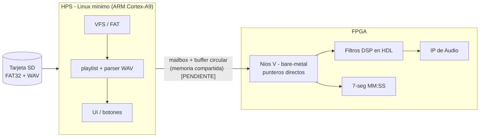

# Reproductor de Audio Avanzado — Co-diseño HW/SW sobre DE1-SoC

Proyecto 2 de Sistemas Empotrados (CE1113), Instituto Tecnológico de Costa Rica,
Escuela de Ingeniería en Computadores. Reproductor de audio WAV sobre una Altera DE-SoC1
(Cyclone V SoC) con procesamiento en hardware propio.

> **Estado del proyecto** — este README documenta lo implementado hasta hoy: la capa de
> **almacenamiento** (SD, WAV, metadatos, playlist) y su verificación en QEMU. Las secciones
> marcadas como *pendiente* todavía no existen. Ver [Estado y pendientes](#estado-y-pendientes).

## Integrantes

| Nombre | GitHub |
|---|---|
| Fabiola Meléndez Sequeira | [@f4bms](https://github.com/f4bms) |
| Irene Muñoz Castro | [@irefut](https://github.com/irefut) |
| Jeremy Serracin Oporta | [@JeremySO202](https://github.com/JeremySO202) |
| Marco Villatoro Chacón | [@M4V1C](https://github.com/M4V1C) |

## Arquitectura propuesta

El HPS (ARM Cortex-A9) y el Nios V se reparten el trabajo según qué recurso toca cada uno.
La SD de la DE1-SoC cuelga del HPS, por eso el almacenamiento vive ahí.



| | HPS (Linux mínimo) | Nios V (bare-metal) |
|---|---|---|
| Rol | SD, metadatos, playlist, UI, botones | Audio en tiempo real, filtros, volumen, 7-seg |
| Acceso a hardware | Drivers del kernel | Punteros directos de `system.h`, sin HAL ni `IOWR/IORD` |
| Pruebas | QEMU (esta etapa) | Questa (como en el Taller 09) |

La interfaz HPS↔Nios V (comandos, buffer circular, eventos de botones y mapa de la RAM
compartida) está definida e implementada en C y verificada en **simulación en el PC**; falta
probarla en la placa. Ver [docs/interfaz-hps-nios.md](docs/interfaz-hps-nios.md). El `main` del
Nios solo debe llamar a la librería `sw/niosv/src/shm_nios.c`.

## Estructura del repositorio

```
.
├── sw/storage/              Biblioteca de almacenamiento (C11, solo stdio/POSIX)
│   ├── wav_meta.[ch]        Parser RIFF/WAV + LIST/INFO
│   ├── playlist.[ch]        Escaneo de directorio, orden y respaldo de metadatos
│   ├── track_reader.[ch]    Lectura de muestras: tramas estéreo de 32 bits para el Nios V
│   ├── main_list.c          Programa de prueba: imprime la playlist
│   ├── main_read.c          Prueba de aceptación: lee todas las canciones y mide MB/s
│   ├── tests/test_storage.c Pruebas unitarias (58 verificaciones)
│   ├── README.md            Guía de integración (API, formato de SD, cómo probar)
│   └── Makefile             Incluye `make dist` (paquete ARM para quien integre)
├── sw/hps/                  Lado HPS de la comunicación con el Nios V
│   ├── player.[ch]          Reproductor: estado, lista, relleno del buffer, avance automático
│   ├── shm_hps.[ch]         RAM compartida: comandos, buffer circular y eventos
│   ├── shm_sink.[ch]        Conecta el reproductor con el protocolo
│   ├── tests/test_comm.c    Simulación HPS + Nios en el PC (77 verificaciones)
│   └── Makefile             `make test` y `make nios-check`
├── sw/niosv/src/            Software del Nios V
│   └── shm_nios.[ch]        Lado Nios del protocolo (para el main; sin libc ni HAL)
├── sw/common/shm_protocol.h Contrato compartido por ambos lados (offsets, comandos, eventos)
├── tools/
│   ├── gen_wavs.py          Genera 11 WAV sintéticos con metadatos
│   ├── mk_sdimg.sh          Arma una imagen FAT32 de SD sin root
│   ├── run_qemu.sh          Arranca el Linux mínimo en QEMU con la SD
│   └── buildroot/           Configuración de Buildroot (defconfig + overlay)
└── docs/
    ├── storage.md           Diseño detallado del módulo de almacenamiento
    └── interfaz-hps-nios.md Protocolo HPS ↔ Nios V, guía para el main del Nios y verificación
```

## Requisitos

Probado en Debian 13.

```bash
sudo apt install build-essential python3 dosfstools mtools \
                 qemu-system-arm qemu-user gcc-arm-linux-gnueabihf \
                 bc wget cpio rsync unzip file     # los últimos para Buildroot
```

## Uso

Todos los comandos se ejecutan desde la raíz del repositorio.

| Objetivo | Comando | Resultado |
|---|---|---|
| Pruebas unitarias (PC) | `make -C sw/storage test` | `58 verificaciones, 0 fallos` |
| Leer las muestras (PC / ARM) | `make -C sw/storage read` · `read-arm` | `11 cancion(es), 0 con fallo` |
| Paquete para integrar (ARM) | `make -C sw/storage dist` | `sw/storage/build/storage-hps.tar.gz` |
| WAV de prueba + imagen SD | `make -C sw/storage sdimg` | `sw/storage/build/sd.img` (FAT32, 256 MB disperso) |
| Listar playlist (PC) | `make -C sw/storage list` | Tabla de canciones |
| Listar playlist (ARM, `qemu-arm`) | `make -C sw/storage list-arm` | Misma tabla, binario ARM estático |
| Construir Linux mínimo | `bash tools/buildroot/build.sh` | Imágenes en `../buildroot-2025.02/output/images` |
| Simulación HPS + Nios (PC) | `make -C sw/hps test` | `77 verificaciones, 0 fallos` |
| Nios compila para RV32I | `make -C sw/hps nios-check RISCV_PREFIX=...` | `OK: shm_nios.c compila para RV32I...` |
| Prueba completa en QEMU | `bash tools/run_qemu.sh` | Arranca, monta la SD, lista y apaga |
| Consola interactiva | `bash tools/run_qemu.sh --shell` | Salir con `Ctrl-A X` |

`build.sh` copia al rootfs el binario `sw/storage/build/main_list_arm`, así que antes hay
que haber corrido `make -C sw/storage list-arm`. El build de Buildroot tarda 20–60 min y
ocupó unos 14 GB de disco.

## Almacenamiento: qué hace y cómo

1. Recorre el directorio donde está montada la SD buscando `*.wav` (sin distinguir mayúsculas).
2. Ordena por nombre y parsea cada archivo **sin leer las muestras**: solo recorre los chunks.
3. Extrae formato, duración y metadatos; descarta los que no sean PCM 16 bit soportado.
4. Si no hay etiquetas, usa el nombre de archivo como respaldo.

### Formato de metadatos

Chunk estándar `LIST` de tipo `INFO` dentro del mismo WAV:

| Subchunk | Campo | Máx. |
|---|---|---|
| `INAM` | Título | 63 caracteres |
| `IART` | Artista | 63 caracteres |
| `IPRD` | Álbum | 63 caracteres |

- **Duración**: `data_size / (frecuencia × canales × 2)`; no es un metadato almacenado.
- **Respaldo por nombre**: `Artista - Titulo.wav` → artista y título; si no hay ` - `, el
  nombre sin extensión es el título y el artista queda como `Desconocido`.
- Formatos aceptados: PCM 16 bit, 1 o 2 canales, 8000 / 16000 / 44100 Hz.

Cómo escribir etiquetas en un WAV propio: `ffmpeg -i in.wav -metadata title="..."
-metadata artist="..." -metadata album="..." out.wav`. El script `tools/gen_wavs.py` ya
genera archivos de ejemplo con este formato.

### Memoria

Sin `malloc`. La playlist es una estructura estática de hasta 32 canciones (~15 KB:
`PLAYLIST_MAX × (256 B de ruta + 212 B de `wav_info_t`)`). El límite se cambia en
`playlist.h`.

## Evidencia de verificación

Salida real de `bash tools/run_qemu.sh` (QEMU `vexpress-a9`, Linux 6.12.9, SD emulada):

```
=== PRUEBA ALMACENAMIENTO ===
11 cancion(es) en /mnt/sd
01 | Aurora             | Los Empotrados  | Primer Boot      | 00:08 | 44100 Hz 2ch
02 | Interrupcion       | Los Empotrados  | Primer Boot      | 00:07 | 44100 Hz 2ch
03 | Latencia           | Nios Quartet    | Registros        | 00:08 | 44100 Hz 1ch
04 | Buffer Circular    | Nios Quartet    | Registros        | 00:06 | 44100 Hz 2ch
05 | Pipeline           | Cyclone Five    | Logica           | 00:09 | 16000 Hz 1ch
06 | Mailbox            | Cyclone Five    | Logica           | 00:08 | 16000 Hz 2ch
07 | Watchdog           | Cyclone Five    | Logica           | 00:07 | 16000 Hz 1ch
08 | Handshake          | Bus Avalon      | Maestro Esclavo  | 00:10 |  8000 Hz 1ch
09 | Overflow           | Bus Avalon      | Maestro Esclavo  | 00:08 |  8000 Hz 1ch
10 | Sin Fin            | Bus Avalon      | Maestro Esclavo  | 00:09 |  8000 Hz 1ch
11 | Cancion Pelada     | Sin Etiquetas   | -                | 00:06 | 16000 Hz 1ch
=== FIN (rc=0) ===
```

La canción 11 no tiene `LIST/INFO`: título y artista salen del nombre de archivo.

| Prueba | Entorno | Qué valida |
|---|---|---|
| `make test` | PC x86_64 | Lógica del parser, la playlist y el lector de muestras (58 verificaciones) |
| `make list-arm` | `qemu-arm` (usuario) | Código en ARM de 32 bits: tipos, `off_t`, endianness |
| `run_qemu.sh` | `qemu-system-arm`, Linux real | Driver MMC, montaje FAT32, nombres largos |

## Limitaciones conocidas

- QEMU `vexpress-a9` emula un controlador SD **PL181**; la placa usa **DW-MMC** del Cyclone
  V. El código de almacenamiento solo usa archivos, así que no cambia, pero el kernel de la
  placa necesita su propio device tree y configuración. **No se ha probado en la DE1-SoC.**
- No se ha medido el tiempo de arranque ni el de cambio de canción (requisitos: < 10 s y
  < 2 s).
- Las etiquetas se tratan como bytes: el contenido no ASCII (UTF-8) pasa sin convertir y
  puede verse mal en un LCD.
- Una canción cuyo nombre exceda 255 caracteres de ruta se omite.

## Estado y pendientes

- [x] Parser WAV con `LIST/INFO` y duración
- [x] Playlist con respaldo por nombre
- [x] Pruebas unitarias, ARM en modo usuario y Linux completo en QEMU
- [x] Lectura de muestras por bloques (`track_reader`) y paquete `make dist` para integrar
- [ ] Envío de las muestras al Nios V (buffer compartido y comandos): a cargo de quien conecte HPS↔Nios V
- [x] Interfaz HPS↔Nios V: protocolo, reproductor del HPS y librería del Nios, simulados en el PC
- [ ] `main` del Nios V (lazo de audio, ISR de botones) y RAM compartida en el `.qsys`
- [ ] Probar la comunicación en la placa (orden de memoria ARM/RISC-V, puente HPS-FPGA, tiempos)
- [ ] Botones por interrupción y UI (LCD/VGA/TFT)
- [ ] Kernel y device tree para la DE1-SoC; prueba en la placa
- [ ] Hardware personalizado, filtros DSP en HDL, 7-seg, volumen por ADC
- [ ] Recursos (Quartus) y consumo (PowerPlay)

## Flujo de trabajo Git

- Ramas: `main` (estable), `develop` (integración), `feat/<tema>` (una por funcionalidad).
- Commits en [Conventional Commits](https://www.conventionalcommits.org/es/): `feat:`,
  `fix:`, `docs:`, `test:`, `build:`, `chore:`.
- Los cambios entran a `develop` por *pull request*; los issues describen cada tarea.

## Licencia

Ver [LICENSE](LICENSE).
