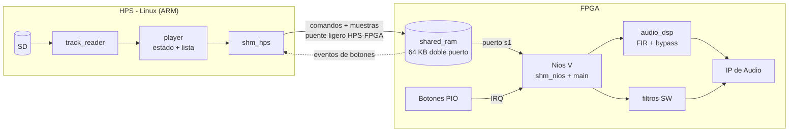
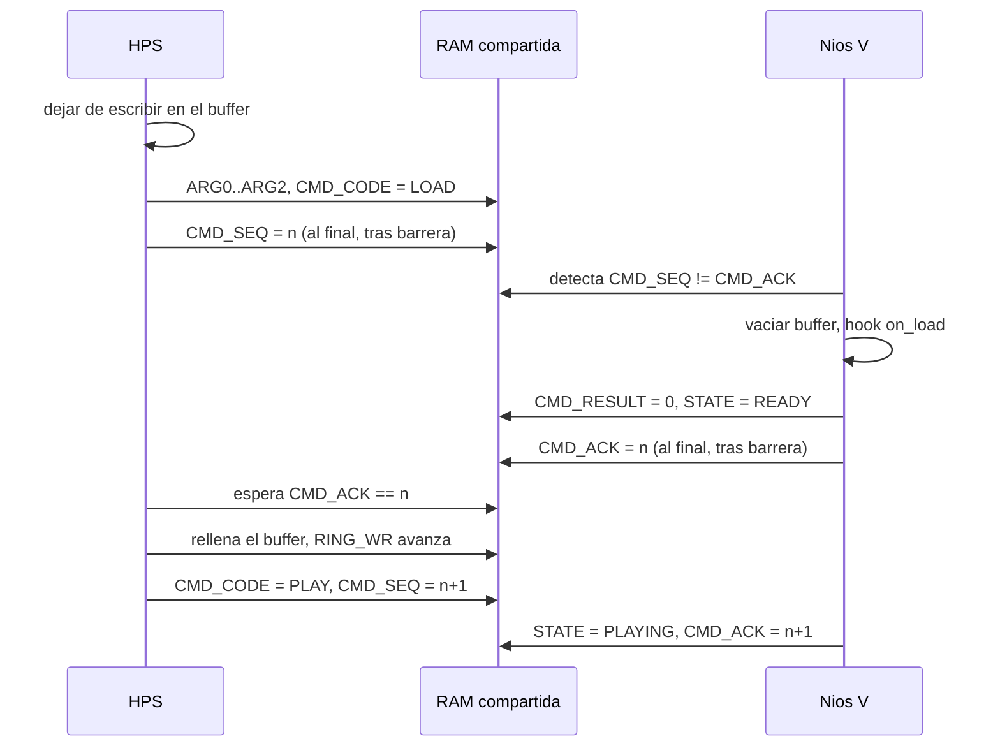

# Interfaz HPS ↔ Nios V (issue A-07)

**Estado:** el protocolo está **implementado en C y verificado en simulación en el PC** (77
verificaciones, 30 ejecuciones sin fallos, y la parte del Nios compila para RV32I sin
dependencias). **No se ha probado en la placa**: falta la RAM compartida en Platform Designer.
Las decisiones de hardware que siguen abiertas están en la
[sección 9](#9-preguntas-abiertas-para-el-equipo).

## 1. Objetivo

El HPS (Linux) lee la SD y entiende el sistema de archivos. El Nios V alimenta el códec de
audio y los filtros en tiempo real. Hace falta un canal entre ambos que:

- entregue las muestras sin cortes aunque Linux se retrase unas decenas de ms,
- permita al HPS ordenar play, pausa, stop y cargar una canción nueva,
- permita al HPS saber el estado (reproduciendo, terminó, filtro activo) y enterarse de los botones,
- **no use cerrojos** entre dos procesadores que no comparten caché ni sistema operativo.

## 2. Reparto de responsabilidades

| HPS (Linux) = el cerebro | Nios V (bare-metal) = el motor de audio |
|---|---|
| Lista de reproducción y estado (reproduciendo, pausa, stop) | Lazo de audio al ritmo del códec |
| Siguiente, anterior, avance automático al terminar | Filtros por software y `audio_dsp` (FIR en hardware) |
| Lectura de la SD y metadatos | Switches de filtro y ADC del volumen |
| Llenar el buffer de muestras | **ISR de botones**: publica eventos, no decide |
| Mostrar la información de la canción | Contador de tiempo MM:SS (7-seg) |

Los botones los atiende el **Nios** con una interrupción de PIO y los entrega al HPS como
*eventos*; el HPS decide qué hacer. Así no hace falta montar interrupciones en Linux (UIO y
device tree) y la latencia sigue muy por debajo de 200 ms.

## 3. Alternativas consideradas

| Opción | Ventajas | Desventajas |
|---|---|---|
| **A. RAM on-chip de doble puerto compartida** (elegida) | Un solo bloque para datos, comandos, estado y eventos. Acceso por punteros en ambos lados. Sin IP extra. | Gasta memoria de la FPGA (M10K). La sincronización la hace el software. |
| B. Buffer en la DDR del HPS, leído por el Nios por el puente FPGA→HPS | Capacidad casi ilimitada. | El Nios pasa a ser maestro del bus del HPS: direcciones, coherencia de caché y latencias más difíciles de depurar. |
| C. IP FIFO de Avalon + mailbox | Control de flujo en hardware, banderas listas. | Profundidad limitada, acceso solo secuencial, más componentes por integrar. |

La C sigue siendo razonable si el equipo prefiere no gastar RAM; el protocolo de comandos
(secciones 5 y 6) no cambiaría.

## 4. Arquitectura y mapa de la RAM compartida



La RAM compartida tiene dos puertos esclavos Avalon-MM: `s1` para el Nios y `s2` para el HPS,
visto a través del puente ligero HPS→FPGA (a partir de `0xFF200000`, ventana de 2 MB). El
tráfico es bajo: 44,1 kHz estéreo con palabras de 32 bits son **176 400 B/s**.

Todas las direcciones son **desplazamientos en bytes** respecto a `SHM_BASE`. La dirección
absoluta la fija quien arme el `.qsys` (Nios) y el device tree (HPS). Tamaño: **64 KiB**.

| Desplazamiento | Tamaño | Contenido |
|---|---|---|
| `0x0000`–`0x00FF` | 256 B | Bloque de control (4.1) y cola de eventos (`0x80`–`0xBF`) |
| `0x0100`–`0x7FFF` | ~32 KiB | Reservado |
| `0x8000`–`0xFFFF` | 32 KiB | Buffer circular: 8192 palabras de 32 bits |

### 4.1 Bloque de control (palabras de 32 bits)

| Offset | Nombre | Escribe | Descripción |
|---|---|---|---|
| `0x00` | `MAGIC` | HPS | `0x41505232` («APR2»). Se escribe **al final** de la inicialización. |
| `0x04` | `VERSION` | HPS | Versión del protocolo (`1`). |
| `0x08` | `CMD_SEQ` | HPS | Número de secuencia del comando; se escribe **al final**. Nunca vale 0 al usarse. |
| `0x0C` | `CMD_CODE` | HPS | Código del comando (sección 6). |
| `0x10` | `CMD_ARG0` | HPS | `LOAD`: frecuencia de muestreo (8000, 16000 o 44100). |
| `0x14` | `CMD_ARG1` | HPS | `LOAD`: total de tramas de la canción. |
| `0x18` | `CMD_ARG2` | HPS | `LOAD`: número de canción (1…N), para el registro `TRACK`. |
| `0x1C` | `CMD_ACK` | Nios | Se iguala a `CMD_SEQ` cuando termina de ejecutar el comando. |
| `0x20` | `CMD_RESULT` | Nios | 0 OK, 1 frecuencia inválida, 2 estado inválido, 3 comando desconocido. |
| `0x24` | `STATE` | Nios | 0 IDLE, 1 READY, 2 PLAYING, 3 PAUSED, 4 ENDED. |
| `0x28` | `FRAMES_PLAYED` | Nios | Tramas **reales** reproducidas de la canción actual. |
| `0x2C` | `FILTER` | Nios | Filtro activo (0 bypass, 1 pasa-bajos, 2 pasa-banda, 3 eco). |
| `0x30` | `VOLUME` | Nios | Volumen 0–100 (ver pregunta abierta 2). |
| `0x34` | `UNDERRUNS` | Nios | Veces que el buffer estaba vacío en reproducción. |
| `0x38` | `RING_WR` | HPS | Contador de palabras escritas (crece sin máscara). |
| `0x3C` | `RING_RD` | Nios | Contador de palabras leídas (crece sin máscara). |
| `0x40` | `EVT_WR` | Nios | Contador de eventos publicados. |
| `0x44` | `EVT_RD` | HPS | Contador de eventos consumidos. |
| `0x48` | `NIOS_MAGIC` | Nios | `SHM_MAGIC` cuando el Nios ya atiende el protocolo. |
| `0x80`–`0xBF` | `EVT[0..15]` | Nios | 16 palabras de evento: `código \| (argumento << 8)`. |

**Regla de oro: cada campo tiene un solo escritor.** Así no hacen falta cerrojos ni
operaciones atómicas entre procesadores. La fuente de verdad de estos valores es
[`sw/common/shm_protocol.h`](../sw/common/shm_protocol.h).

## 5. Buffer circular

- Cada elemento es una palabra de 32 bits: `[15:0]` = izquierdo, `[31:16]` = derecho, PCM de
  16 bits con signo. **Es el mismo formato que `SAMPLE_IN` de `audio_dsp`** (F-03) y que
  `track_read`, así que no hay que reempaquetar nada.
- Los WAV mono los **duplica `track_read`** (L = R): el buffer siempre contiene tramas estéreo.
- Tamaño `RING_WORDS = 8192` (potencia de 2). `RING_WR` y `RING_RD` son enteros sin signo de 32
  bits que crecen sin máscara; el índice real es `contador & 8191`.
  - Ocupadas: `RING_WR - RING_RD`. Libres: `8192 - (RING_WR - RING_RD)`.
  - La aritmética modular hace correcto el cálculo aunque los contadores den la vuelta.
- **Productor (HPS):** escribe las palabras, ejecuta una barrera de memoria y *después*
  actualiza `RING_WR`.
- **Consumidor (Nios):** lee `RING_WR`, barrera, lee la palabra, barrera y *después* actualiza
  `RING_RD`.
- `SHM_BARRIER()` es `__sync_synchronize()`, que genera `dmb` en ARM y `fence` en RISC-V.

### 5.1 Capacidad

| fs | Duración del buffer lleno (8192 tramas) |
|---|---|
| 44 100 Hz | 186 ms |
| 16 000 Hz | 512 ms |
| 8 000 Hz | 1,02 s |

El HPS debe llamar a `player_tick()` cada ~10 ms; cada llamada rellena hasta llenar el buffer.
El margen contra un retraso de Linux a 44,1 kHz es de ≈ 90–186 ms según el llenado. **Es una
estimación, no una medición**; hay que validarla en la placa. Si no alcanza, se duplica el
buffer a 16 384 palabras (371 ms) con una RAM compartida de 128 KiB.

### 5.2 Vacío (underrun) y fin de canción

- Si el Nios está en `PLAYING` y el buffer está vacío, `shm_nios_pop_frame` devuelve 0 e
  incrementa `UNDERRUNS`; el `main` envía **una trama de silencio** al códec para no perder el
  ritmo. No cuenta para `FRAMES_PLAYED`.
- No hay marca de fin dentro del flujo. `LOAD` informa el total de tramas. Cuando
  `FRAMES_PLAYED == total`, el Nios pasa solo a `ENDED`. El HPS lo detecta y carga la siguiente.
- Si un archivo está cortado y las tramas no alcanzan, el HPS (`player_tick`) lo detecta y salta
  a la siguiente canción en lugar de esperar para siempre.

## 6. Comandos (mailbox)

El HPS escribe los argumentos y el código, luego `CMD_SEQ`, y espera `CMD_ACK == CMD_SEQ`
(límite de 100 ms). Nunca envía un comando nuevo mientras el anterior no esté confirmado.

| Código | Comando | Argumentos | Efecto en el Nios |
|---|---|---|---|
| 1 | `LOAD` | `ARG0`=fs, `ARG1`=tramas, `ARG2`=nº de canción | Vacía el buffer (`RING_RD := RING_WR`), `FRAMES_PLAYED = 0`. Gancho `on_load`: configurar `FS`/`TRACK` de `audio_dsp` y reiniciar filtros. → `READY` |
| 2 | `PLAY` | — | Gancho `on_play` (arrancar el contador). → `PLAYING`; si la canción tiene 0 tramas, → `ENDED` |
| 3 | `PAUSE` | — | Detiene el consumo **sin** vaciar el buffer. Gancho `on_pause`. → `PAUSED` |
| 4 | `STOP` | — | Vacía el buffer, tiempo a cero. Gancho `on_stop`. → `IDLE` |

Transiciones válidas (cualquier otra devuelve `CMD_RESULT = 2`; `LOAD` con una frecuencia que no
sea 8000, 16000 o 44100 devuelve 1 y no cambia nada):

| Desde | `LOAD` | `PLAY` | `PAUSE` | `STOP` |
|---|---|---|---|---|
| IDLE / ENDED | READY | — | — | IDLE |
| READY | READY | PLAYING | — | IDLE |
| PLAYING | READY | — | PAUSED | IDLE |
| PAUSED | READY | PLAYING | — | IDLE |

Siguiente y anterior **no existen** en el protocolo: la lista vive en el HPS, que emite `LOAD`
con la otra canción y luego `PLAY`.



### 6.1 Arranque y reinicio

1. El HPS llama a `shm_hps_init`: pone `MAGIC = 0`, espera 2 ms, borra el bloque de control y
   escribe `MAGIC` al final.
2. El Nios (`shm_nios_service`) ve el `MAGIC`, se deja limpio y escribe `NIOS_MAGIC`.
3. El HPS espera con `shm_hps_wait_nios` **antes del primer comando**. El Nios puede arrancar más
   lento que Linux.
4. Si el Nios se reinicia solo (el `NIOS_MAGIC` ya estaba puesto), ignora el último comando
   guardado para no repetirlo.
5. Si un comando vence por tiempo (`-1`), lo más seguro es repetir `shm_hps_init` y volver a
   cargar la canción.

### 6.2 Eventos Nios → HPS (botones)

La ISR de botones llama a `shm_nios_push_event(&n, SHM_EVT_BTN_NEXT, 0)`. Cola de 16 eventos;
si se llena, se descartan los nuevos. El HPS los lee en `player_tick`.

| Código | Evento |
|---|---|
| 1 | `SHM_EVT_BTN_PLAYPAUSE` |
| 2 | `SHM_EVT_BTN_STOP` |
| 3 | `SHM_EVT_BTN_NEXT` |
| 4 | `SHM_EVT_BTN_PREV` |

La latencia de un botón es la de la ISR (microsegundos) más el sondeo del HPS (~10 ms) más un
comando (~1 ms): muy por debajo de los 200 ms del enunciado. **Estimado, no medido.**

## 7. Para quien escriba el `main` del Nios

La librería está en [`sw/niosv/src/shm_nios.h`](../sw/niosv/src/shm_nios.h) y
[`shm_nios.c`](../sw/niosv/src/shm_nios.c). Solo usa punteros `volatile` (sin `alt_*` ni
`IOWR/IORD`), sin libc y sin multiplicaciones. El `main` solo hace lo de abajo; el protocolo ya
está resuelto.

```c
#include "shm_nios.h"

static void on_load(void *ctx, uint32_t fs, uint32_t total, uint32_t track)
{
    /* configurar FS y TRACK de audio_dsp, filters_sw_init(fs), HIST_CLR, TIME_CLR */
}
static void on_play(void *ctx)  { /* CTRL.TIME_EN = 1 */ }
static void on_pause(void *ctx) { /* CTRL.TIME_EN = 0 */ }
static void on_stop(void *ctx)  { /* CTRL.TIME_EN = 0, TIME_CLR */ }

int main(void)
{
    shm_nios_t n;
    shm_nios_hooks_t hooks = { on_load, on_play, on_pause, on_stop, NULL };

    shm_nios_init(&n, (volatile uint32_t *)SHM_RAM_BASE /* de system.h */, &hooks);
    for (;;) {
        shm_nios_service(&n);                 /* atiende los comandos del HPS */
        shm_nios_set_filter(&n, leer_switches());
        shm_nios_set_volume(&n, leer_adc());
        if (codec_tiene_espacio()) {
            uint32_t trama;
            int r = shm_nios_pop_frame(&n, &trama);
            if (r == 1)      escribir_al_codec(aplicar_filtro(trama));
            else if (r == 0) escribir_al_codec(0);   /* vacio: silencio */
        }
    }
}
/* ISR de botones: shm_nios_push_event(&n, SHM_EVT_BTN_NEXT, 0); */
```

Lista de comprobación para ese `main`:

- [ ] Llamar a `shm_nios_service` en **cada vuelta**, más a menudo que cada ~1 ms.
- [ ] No bloquear el lazo esperando al códec: si no hay espacio, seguir dando vueltas.
- [ ] Si algún filtro tarda más que `f_clk / fs` ciclos por trama, el códec se quedará sin datos.
- [ ] La ISR de botones solo publica el evento; no debe llamar a `shm_nios_service`.
- [ ] `SHM_RAM_BASE` sale de `system.h`; el HPS debe ver la misma memoria por el puente.
- [ ] Verificar con `make -C sw/hps nios-check` que `shm_nios.c` sigue compilando para RV32I.

## 8. Lado HPS (Linux)

| Archivo | Qué hace |
|---|---|
| [`sw/hps/shm_hps.c`](../sw/hps/shm_hps.c) | `mmap` de la RAM compartida, comandos con ACK, buffer circular y eventos |
| [`sw/hps/player.c`](../sw/hps/player.c) | Estado, lista, relleno del buffer con `track_read`, avance automático |
| [`sw/hps/shm_sink.c`](../sw/hps/shm_sink.c) | Conecta el reproductor con el protocolo |

Uso básico en el HPS:

```c
volatile uint32_t *mem = shm_hps_map("/dev/mem", 0xFF200000 + OFFSET_SHM, SHM_SIZE_BYTES);
shm_hps_t hps;   shm_hps_init(&hps, mem);   shm_hps_wait_nios(&hps, 2000);
player_sink_t sink;  shm_sink_init(&sink, &hps);
player_t player;     player_init(&player, &pl, &sink);   /* pl viene de playlist_scan */
for (;;) {           /* cada ~10 ms, siempre desde el mismo hilo */
    player_tick(&player);
    usleep(10000);
}
/* desde la UI o la consola: player_play_pause / player_next / player_prev / player_stop */
```

`OFFSET_SHM` depende de la dirección de la RAM compartida en Platform Designer. **`shm_hps_map`
no se ha probado en la placa.** Escrituras siempre de 32 bits (no `memcpy` sobre memoria de
dispositivo). Todas las funciones `player_*` se llaman desde un solo hilo.

## 9. Preguntas abiertas para el equipo

1. **RAM compartida en el `.qsys`:** doble puerto de 64 KiB, `s1` al Nios y `s2` al puente
   ligero. ¿Caben junto con la RAM del Nios, el buffer del eco (~17,6 KB) y el resto? Verificar
   con el reporte de Quartus. ¿Qué dirección base?
2. **Volumen:** ¿lo lee el Nios del ADC AD7928 y lo publica en `VOLUME`, o el HPS lo lee directo
   por el puente? Propuesta: el Nios (ya lleva los switches y el lazo de audio).
3. **Frecuencias del códec.** Verificar que el IP de Audio/WM8731 acepte **16 kHz** (el
   enunciado exige 8, 16 y 44,1 kHz). Si no, el HPS debe remuestrear 16→32 kHz.
4. **Reloj del Nios V** y presupuesto de ciclos por trama frente al costo medido de los filtros.
5. **Sondeo o interrupción** para el rellenado. Se empieza con sondeo cada 10 ms.
6. **Tamaño del buffer:** 32 KiB (186 ms a 44,1 kHz) o 64 KiB.
7. **Pantalla:** ¿LCD, VGA o TFT? Decide quién necesita los metadatos y si el HPS debe publicar
   cadenas en la RAM compartida.

## 10. Verificación

`make -C sw/hps test` ejecuta el reproductor del HPS y un **Nios simulado** (la misma
`shm_nios.c`) como dos hilos sobre un arreglo que hace de RAM compartida. Un «códec» simulado
guarda todo lo que recibe y se compara contra los archivos, trama por trama.

| Caso | Qué valida |
|---|---|
| Lista completa y vuelta | 3 canciones (8 kHz mono, 16 kHz y 44,1 kHz estéreo), avance automático y regreso a la primera; la tercera supera el buffer, así que ejercita la vuelta y la contrapresión |
| Pausa y reanudar | El consumo se detiene exacto y se reanuda sin perder ni repetir tramas |
| Controles y botones | Siguiente, anterior, stop y eventos de botones inyectados desde el lado Nios |
| Underrun | El HPS se atrasa, el Nios queda sin datos y luego todo se recupera sin pérdidas |
| Comandos inválidos | Estado inválido, frecuencia inválida, comando desconocido, canción de 0 tramas, tiempo límite sin Nios |

**Resultado:** 77 verificaciones, 0 fallos; 30 ejecuciones seguidas (10 de ellas con la CPU
saturada) sin una sola falla.

`make -C sw/hps nios-check` compila `shm_nios.c` para **RV32I** (`-ffreestanding`) y comprueba
que no queden símbolos externos, es decir, sin `__mulsi3` ni `__divsi3`.

**Lo que esta simulación NO valida:** el orden de memoria real entre ARM y RISC-V (en x86 el
orden es más fuerte), el puente HPS-FPGA, los tiempos con un códec de verdad, ni la ISR de
botones. Todo eso requiere la placa.

## 11. Criterios de aceptación de A-07

- [x] Protocolo definido en `sw/common/shm_protocol.h` y documentado.
- [x] Lado Nios (`shm_nios`) y lado HPS (`shm_hps`, `player`) implementados.
- [x] Verificado en simulación en el PC.
- [ ] Revisado y aprobado por el equipo (preguntas 1 y 2 en particular).
- [ ] RAM compartida agregada al `.qsys` y al device tree.
- [ ] Probado en la placa.
