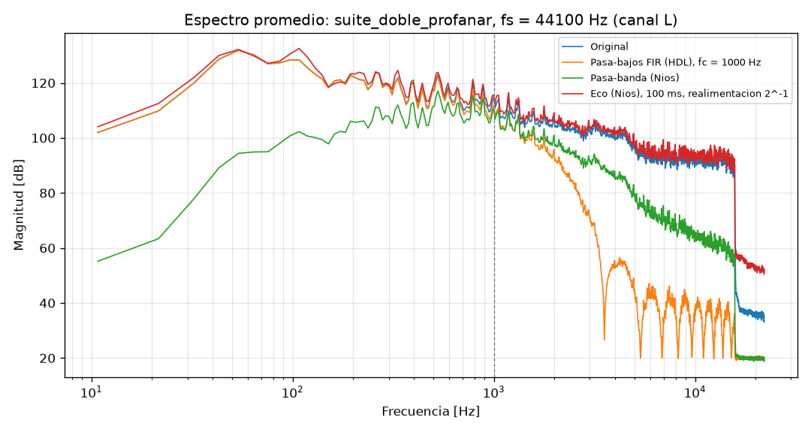
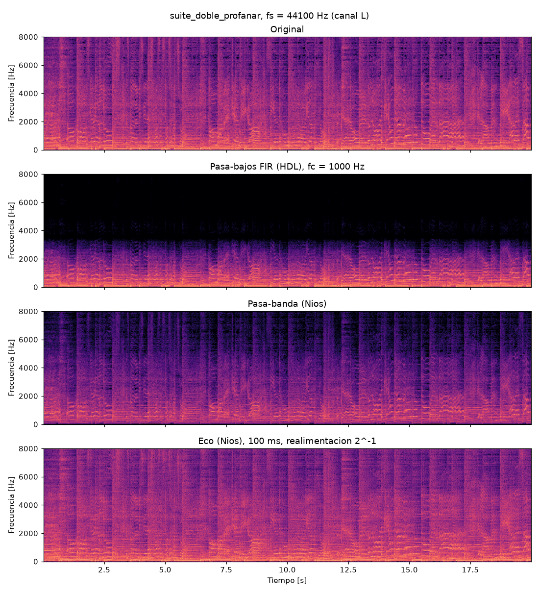

# Filtros probados con audio real (modelo bit a bit)

Prueba de los tres filtros con **música real**, antes de tenerlos en la placa. Se usan los mismos modelos de punto fijo de `tools/gen_coefs.py` que verifican el hardware (`tb_fir_pbajo`, `tb_audio_dsp`) y el software del Nios (`test_filters_sw`), así que lo que se escucha es lo mismo que darán el FIR en HDL y los filtros en el Nios V.

| Dato | Valor |
|---|---|
| Script | `tools/filtrar_wav.py` |
| Canción | *Suite Doble – Profanar*, WAV 16 bits estéreo, 44.1 kHz |
| Fragmento | 20 s desde el segundo 46 (882 000 pares) |
| Salida de audio | `build/audio_filtros/` (fuera de git: la canción tiene derechos de autor) |

```bash
# Desde: raíz del repo (con el .venv activo) (comillas si la ruta tiene espacios)
python tools/filtrar_wav.py "<ruta>/Suite Doble - Profanar.wav" --inicio 46 --dur 20
```

El FIR se calcula con `numpy` para que sea rápido, pero el script comprueba que da **lo mismo que `model_fir`** antes de seguir. El pasa-banda y el eco usan directamente `model_pb` y `model_echo`.

## 1. Resultados

| Salida | Pico | Muestras saturadas | Cómo suena |
|---|---|---|---|
| Original | 32768 | 0.03 % | — |
| Pasa-bajos FIR (HDL) | 32718 | 0.00 % | Apagado, sin agudos ("detrás de una pared") |
| Pasa-banda (Nios) | 17594 | 0.00 % | Sin graves ni agudos ("como radio"); más bajo de volumen |
| Eco (Nios) | 32768 | 0.20 % | Repetición clara a los 100 ms, sin distorsión audible |

## 2. Espectro



- **FIR:** sigue al original hasta ~1 kHz y cae rápido después: unos −60 dB arriba de ~3.5 kHz, con los lóbulos laterales propios de 32 taps con ventana Hamming.
- **Pasa-banda:** atenúa los graves (más de −40 dB por debajo de ~30 Hz) y los agudos (unos −25 dB a 10 kHz), y deja pasar la zona de ~300 Hz a 1 kHz.
- **Eco:** mismo contenido que el original, con un poco más de energía por la suma de las repeticiones.
- El corte de todas las curvas en ~16 kHz viene en el archivo original: el audio viene de YouTube, que lo comprime con pérdida (AAC/Opus) y descarta lo que está por encima de ~16 kHz. No lo producen los filtros.



## 3. Observaciones

- **Volumen más bajo.** Al quitar parte del espectro se pierde energía, sobre todo en el pasa-banda (pico de 17 594, cerca de −5.4 dB respecto al original). Es esperado, y se compensa con el registro `GAIN` de `audio_dsp` (hasta ×2), que se aplica a la salida de los tres filtros.
- **Saturación del eco.** Con `y = x + (y[n−D] >> 1)`, una señal cerca del máximo puede crecer hasta el doble. Depende de la canción: con esta, 0.20 % de muestras saturadas (no se oye); con una canción masterizada más fuerte (*Watch Me*, K/DA) llegó a 4.5 % y se oyen crujidos en las partes fuertes. Si hiciera falta, se corrige atenuando la entrada: `y = (x >> 1) + (y[n−D] >> 1)`, que limita el pico al de la entrada y sigue sin multiplicaciones.
