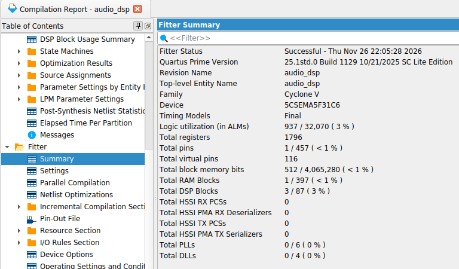
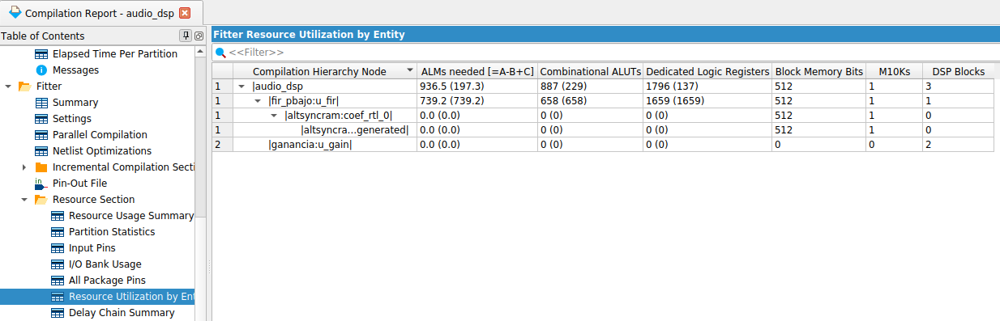
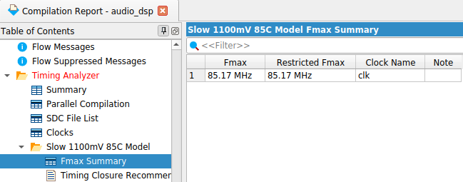
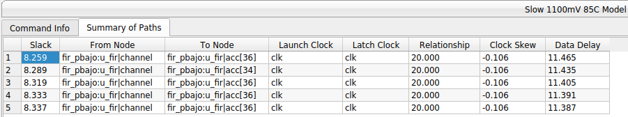
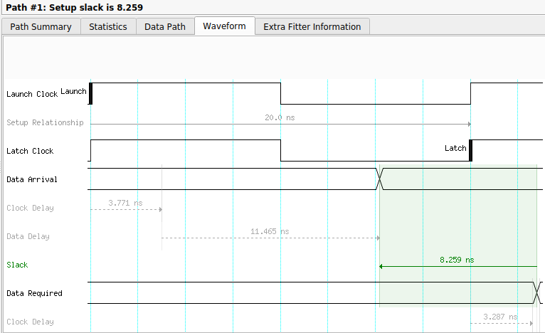
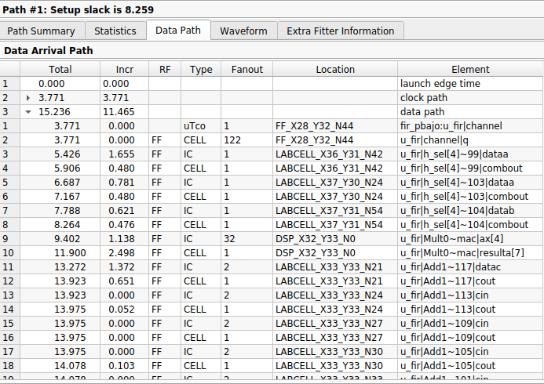
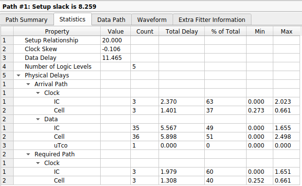

# Recursos y tiempo de `audio_dsp` en Quartus

`audio_dsp` compilado **solo** (sin el resto del sistema) para medir sus recursos por submódulo y su frecuencia máxima. Insumo para el análisis de recursos y la documentación del hardware.

| Dato | Valor |
|---|---|
| Herramienta | Quartus Prime Lite 25.1std |
| Dispositivo | Cyclone V **5CSEMA5F31C6** (DE1-SoC) |
| Reloj | 20 ns (**50 MHz**) en `CLOCK_50` (PIN_AF14), igual que el del Nios V |
| Demás puertos | **Pines virtuales** (116): dentro del sistema el bus Avalon y los displays son conexiones internas |
| Script | `tools/recursos_audio_dsp.sh` |
| Resumen completo | `docs/verifica/recursos_audio_dsp.txt` |

> **Actualizado el 2026-11-28 con `time_7seg` completo.** Los números de las tablas son de esa compilación. Las capturas de pantalla son de la compilación anterior (26-nov, sin `time_7seg`): el análisis no cambia, porque el peor camino sigue siendo el MAC del FIR (ver sección 4).

## 1. Síntesis

- **0 errores, 0 critical warnings y 0 latches** en síntesis, Fitter y Timing Analyzer.
- Las únicas advertencias son normales para un módulo compilado solo se ven en la siguiente tabla:

| Warning | Motivo |
|---|---|
| 276020: *Inferred RAM node `coef_rtl_0`* | Los 32 coeficientes se guardan en memoria de bloque (optimización) |
| 292013: *LogicLock* requiere licencia | Función de la edición de pago y no se está usando |

> Con los puertos como pines **reales** en lugar de virtuales, el Fitter daba además un *Critical Warning* 169085 (117 pines sin ubicación) y advertencias de E/S y de reloj. Se eliminaron marcando los puertos como **pines virtuales** y el reloj en `CLOCK_50`, que es como queda el módulo dentro del sistema.

## 2. Recursos finales por submódulo (Fitter)





| Submódulo | ALMs necesarios | ALUTs combinacionales | Registros | Memoria de bloque | M10K | DSP | Qué ocupa |
|---|---|---|---|---|---|---|---|
| **`audio_dsp` completo** | **1031.5** | **1042** | **1870** | 512 bits | **1** | **3** | ~**3 %** de los 32 070 ALMs |
| └ envoltura `audio_dsp` | 196.5 | 229 | 137 | — | — | — | Decodificación del bus y registros (CTRL, GAIN, FS, TRACK, FRAME_CNT, SAMPLE_IN/OUT) |
| └ `fir_pbajo` | 736.7 | 655 | 1659 | 512 bits | 1 | 1 | Historial L/R, multiplexores y control del MAC; coeficientes en memoria |
| └ `ganancia` | 0 | 0 | 0 | — | — | 2 | Los dos multiplicadores caben enteros en bloques DSP |
| └ `time_7seg` | 98.3 | 158 | 74 | — | — | — | Preescalador (17), contadores BCD (15) y displays registrados (42); decodificadores y conversión BCD → binario |

Los números entre paréntesis de Quartus (los de cada submódulo **solo**) son los de las filas `└`; la fila del módulo completo suma todo.

| Recurso | Usado | Disponible | % |
|---|---|---|---|
| ALMs | 1031.5 | 32 070 | ~3 % |
| Registros | 1870 | — | — |
| Bloques DSP | 3 | 87 | ~3.4 % |
| Memoria de bloque | 512 bits (1 de 397 M10K) | 4 065 280 bits | < 0.1 % |

**Observación de diseño:** `fir_pbajo` usa muchos registros porque el historial (32 muestras × 16 bits × 2 canales = 1024 bits) es un registro de desplazamiento, y los coeficientes se leen de forma combinacional desde dos puertos (MAC y bus). Se podría reducir el área moviendo el historial a M10K con un buffer circular, a cambio de más complejidad y un ciclo más de latencia por tap. Como ahora se está usando alrededor del 3 % del FPGA, se prioriza la **simplicidad y la verificabilidad**, ya que no es un impedimento e igual cumple con los paramétros límites de la especificación.

## 3. Frecuencia máxima



| Modelo | Fmax | Reloj del sistema | Holgura (slack) |
|---|---|---|---|
| Slow 1100 mV, **85 °C** (peor caso) | **86.87 MHz** | 50 MHz | **+8.489 ns** |
| Slow 1100 mV, 0 °C | 86.36 MHz | 50 MHz | — |

Sin `time_7seg` (26-nov) era 85.17 MHz con +8.259 ns: la diferencia es solo de ubicación y ruteo del Fitter.

El módulo funciona a 50 MHz con un **74 % de margen**. El *Multicorner Timing Analysis Summary* (setup, hold, recovery y removal en los cuatro modelos *Slow/Fast* a 85 °C y 0 °C) no reporta problemas.

**Caminos sin restricción.** El reporte marca como *unconstrained* las 41 entradas (`rst`, `avs_address`, `avs_read`, `avs_write`, `avs_writedata`) y las 33 salidas (`avs_readdata`, `avs_waitrequest`) del bus, porque en este proyecto de prueba no hay retardos externos definidos. 
Es esperado: dentro del sistema que esos puertos se conectan al bus del Nios **dentro del FPGA y con el mismo reloj**, y Platform Designer restringe esos caminos. Todo el tiempo interno del módulo (registro a registro con `clk`) está restringido y cumple con los requisitos de la especificación. 
No tenemos relojes ilegales ni sin restricción. El MAC en un solo ciclo (multiplicador 16×16 + suma de 37 bits) **no necesita pipeline**.

## 4. Camino crítico



| Slack | Desde | Hasta | Retardo de datos |
|---|---|---|---|
| 8.259 ns | `fir_pbajo:u_fir\|channel` | `fir_pbajo:u_fir\|acc[36]` | 11.465 ns |

> Con `time_7seg` (28-nov) los 5 peores caminos siguen dentro del MAC del FIR: el primero va de `u_fir|k[3]` a `u_fir|acc[28]` (slack 8.489 ns, retardo de datos 11.230 ns). `time_7seg` no aparece entre ellos: su camino más largo (preescalador ≥ `fs − 1` → contadores) es mucho más corto que un multiplicador más una suma de 37 bits. El detalle de abajo es el de la compilación del 26-nov y sigue siendo representativo.

El camino critico es el siguiente:

```
channel ─► MUX L/R (selecciona hist_l / hist_r) ─► MUX 32:1 (k) ─► h_sel ─► × c_sel (DSP) ─► + acc (37 bits) ─► acc[36]
```

El registro `channel` (L o R) controla el multiplexor que elige el historial de cada canal, así que su salida llega a los 16 bits de `h_sel` y de ahí al MAC.



Cómo leer la forma de onda (camino #1, modelo Slow 1100 mV 85 °C):

| Elemento | Valor | Significado |
|---|---|---|
| *Launch Clock* | 0 ns | Flanco que lanza el dato desde `channel` |
| *Clock Delay* (origen) | 3.771 ns | Lo que tarda el reloj en llegar a `channel` |
| *Data Delay* | **11.465 ns** | Lo que tarda el dato en pasar por los multiplexores, el DSP y el sumador hasta `acc[36]` |
| *Latch Clock* | 20 ns | Flanco siguiente, en que `acc` captura el dato |
| *Clock Delay* (destino) | 3.287 ns | Lo que tarda el reloj en llegar a `acc` |
| ***Slack*** | **+8.259 ns** | Tiempo que sobra entre la llegada del dato y el momento en que se necesita (zona verde) |

El reporte se generó con `-multi_corner`: *"Found 5 setup paths (0 violated). Worst case slack is 8.259"*, es decir, es el peor caso entre los cuatro modelos.

### Etapas del camino crítico



| Etapa | Elemento en Quartus | Llega a (ns) | Qué es? |
|---|---|---|---|
| Origen | `u_fir\|channel` → `q` | 3.771 | Registro que elige L o R; alimenta a 122 destinos (*fanout*) |
| Multiplexor | `u_fir\|h_sel[4]~99`, `~103`, `~104` | 8.264 | 3 niveles de LUT: multiplexor L/R y 32:1 que forma `h_sel` |
| Multiplicador | `u_fir\|Mult0~mac` | 11.900 | Bloque DSP 16×16 (2.498 ns por sí solo) |
| Sumador | `u_fir\|Add1~...` (`cin`/`cout`) | 15.236 | Suma de 37 bits `acc + producto` en la cadena de acarreo, hasta `acc[36]` |

La suma no se hace dentro del DSP: el DSP solo multiplica y la acumulación usa lógica con cadena de acarreo. Por eso el peor camino termina en el bit más alto del acumulador.



Del retardo de datos (11.465 ns), **49 % es ruteo** (5.567 ns) y **51 % es lógica** (5.898 ns), en **5 niveles de lógica**: un camino equilibrado, sin un único cuello de botella.

Los cinco peores caminos son el MAC del FIR y terminan en los bits altos del acumulador (propagación del acarreo). Si hiciera falta más velocidad, la mejora más significativa sería registrar `h_sel` y `c_sel` antes del multiplicador (agregar una etapa de pipeline).

## 5. Cómo utilizar el tool

```bash
# Desde: raíz del repo ('qenv' en WSL)
tools/recursos_audio_dsp.sh
```

Recompila en `build/recursos_audio_dsp/` (.gitignore) y reescribe `docs/verifica/recursos_audio_dsp.txt`.
