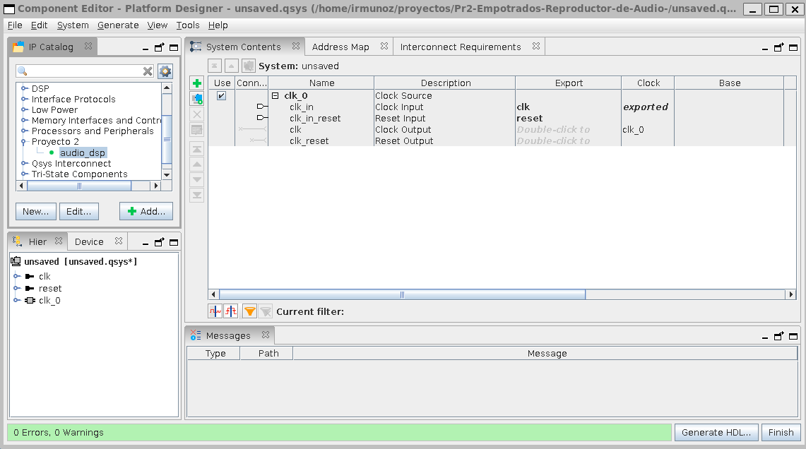
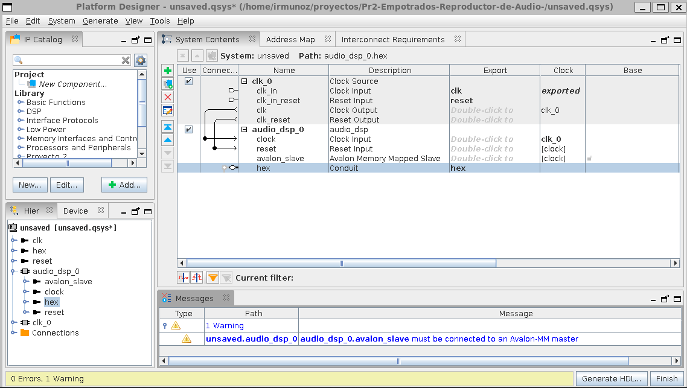
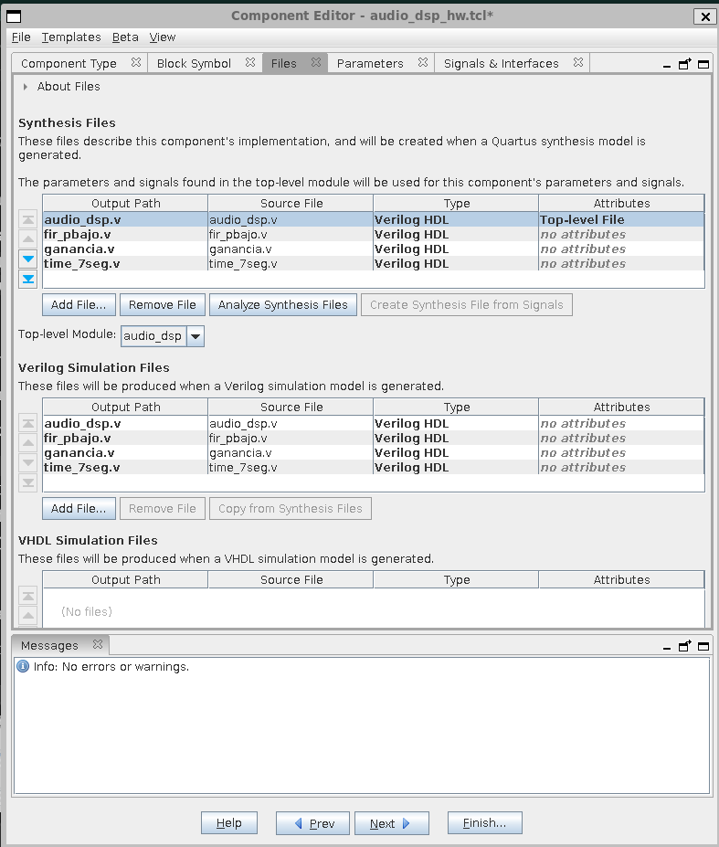
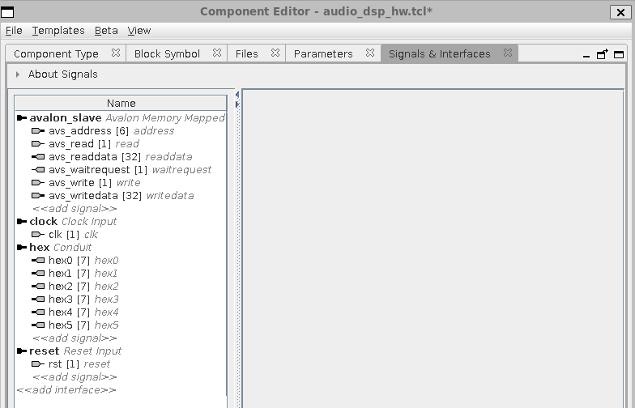

# --- Para integración de módulo "audio_dsp" ---

Este es el módulo de HW personalizado del reproductor ya el completo:
periférico **Avalon-MM esclavo** con el filtro pasa-bajos FIR propio (`fir_pbajo`), bypass, ganancia de volumen (`ganancia`) y tiempo MM:SS con los displays de 7 segmentos (`time_7seg`).

Estos son los archivos que tiene:

| Archivo | Qué es? |
|---|---|
| `audio_dsp.v` | Módulo top del componente (bus, registros, camino de la muestra) |
| `fir_pbajo.v` | Filtro pasa-bajos FIR (instanciado dentro de `audio_dsp`) |
| `ganancia.v` | Escalamiento de volumen por canal, Q1.12 (instanciado dentro de `audio_dsp`) |
| `time_7seg.v` | Tiempo MM:SS y displays de 7 segmentos (instanciado dentro de `audio_dsp`). Ver sección 7 |
| `audio_dsp_hw.tcl` | Descripción del componente para Platform Designer (interfaces, archivos). Se puede abrir y editar con el *Component Editor* |

> **Acá no se asignan los pines.** Solo son las salidas con nombre (`hex0`..`hex5`). Los pines se asignan en el `.qsf` del proyecto; así si se cambian, este archivo de `audio_dsp.v` no necesita cambiar.

---

## 1. Interfaces del componente

| Puerto | Dir | Ancho | Interfaz en Platform Designer | Conectar a |
|---|---|---|---|---|
| `clk` | in | 1 | `clock` | El mismo reloj del Nios V (50 MHz) |
| `rst` | in | 1 | `reset` (**activo en alto**) | El reset del sistema |
| `avs_address` | in | 6 | `avalon_slave` · address | `data_manager` del Nios V |
| `avs_read` | in | 1 | `avalon_slave` · read | 〃 |
| `avs_readdata` | out | 32 | `avalon_slave` · readdata | 〃 |
| `avs_write` | in | 1 | `avalon_slave` · write | 〃 |
| `avs_writedata` | in | 32 | `avalon_slave` · writedata | 〃 |
| `avs_waitrequest` | out | 1 | `avalon_slave` · waitrequest | 〃 |
| `hex0`..`hex5` | out | 7 c/u | `conduit` "hex" (**exportar**) | Top-level → pines HEX0..HEX5 |

Parámetros de `avalon_slave`:

- Ancho de datos: **32 bits**
- Direccionamiento: **por palabra** (`avs_address[5:0]` = 64 palabras → **256 bytes** de espacio)
- Latencia de lectura: **0**, con **waitrequest**
- Sin `byteenable` (el Nios siempre accede a 32 bits)

## 2. Pasos para lo del Platform Designer

1. Agregar la carpeta `hw/ip/audio_dsp/` a la ruta de búsqueda de IP: *Tools → Options → IP Search Path → Add*.
   - Quartus en Linux / WSL: `<repo>/hw/ip/audio_dsp`
   - Quartus en Windows con el repo en WSL: `\\wsl.localhost\Ubuntu\<ruta del repo>\hw\ip\audio_dsp`. Si no aparece en el catálogo, el repo tiene que estar en una ruta de Windows.

   Aparece en el *IP Catalog* como **Proyecto 2 → audio_dsp**:

   

2. Agregar **audio_dsp** al sistema (*Add… → Finish*, no tiene parámetros).
3. Conectar `clock` y `reset` a los mismos del Nios V.
4. Conectar `avalon_slave` al **`data_manager`** del Nios V.
5. Asignar una **dirección base alineada a 256 bytes** (por ejemplo `0x0001_0000`), *System → Assign Base Addresses* o a mano, no recuerdo si el profe había propuesto alguna en la especificación.
6. En la columna *Export* del conduit **hex**, poner un nombre (por ejemplo, recomiendo `audio_dsp_hex` para mantenerlo coherente).
7. Generar el sistema (*Generate HDL*). En `system.h` del BSP debe aparecer la base, p. ej. `AUDIO_DSP_0_BASE`.

Así queda conectado en un sistema de prueba (solo reloj y reset, sin Nios). El único warning es que `avalon_slave` todavía no tiene maestro: este warning se quita al conectarlo al `data_manager` del Nios V.



### 2.1 Revisión del componente (En Component Editor)

Clic derecho sobre `audio_dsp` en el catálogo → *Edit*. Con el `audio_dsp_hw.tcl` del repo: los 4 `.v` con `audio_dsp.v` como *Top-level*, *Analyze Synthesis Files* sin errores ni advertencias, y las 4 interfaces de la sección 1.





> Si se abre en el *Component Editor* solo para revisar, cerrarlo **sin guardar**: al guardar reescribe el `.tcl` en su formato y se pierden los comentarios (el contenido es el mismo).

## 3. Conexión en el top-level

El Platform Designer genera un puerto por cada señal del conduit exportado, con el prefijo del nombre de exportación. 
Los nombres exactos dependen del nombre que se dé al exportar. Se puede usar por ejemplo:

```verilog
    .audio_dsp_hex_hex0 (HEX0),
    .audio_dsp_hex_hex1 (HEX1),
    .audio_dsp_hex_hex2 (HEX2),
    .audio_dsp_hex_hex3 (HEX3),
    .audio_dsp_hex_hex4 (HEX4),
    .audio_dsp_hex_hex5 (HEX5),
```

- `HEX1..HEX0` = segundos, `HEX3..HEX2` = minutos, `HEX5..HEX4` = número de canción
- Segmentos **activos en bajo** (`0` = encendido), igual que en la DE1-SoC
- Si se quiere otro orden de displays, se cambia **en esta parte** (o en el `.qsf`), no en `audio_dsp.v`

## 4. Mapa de registros

Offset en bytes desde la base (`avs_address` = offset / 4). Están también en la documentación interna del .v, lo dejo acá para no tener que ir a buscarlo.

| Offset | Registro | Acceso | Bits |
|---|---|---|---|
| `0x00` | `ID` | RO | `0x41554431` ("AUD1") |
| `0x04` | `CTRL` | RW | `[0]` FIR_EN · `[1]` HIST_CLR (pulso) · `[2]` TIME_EN · `[3]` TIME_CLR (pulso) · `[4]` HEX_EN |
| `0x08` | `STATUS` | RO / W1C | `[0]` BUSY · `[1]` SAT (escribir 1 lo borra) |
| `0x0C` | `SAMPLE_IN` | WO | `[15:0]` L · `[31:16]` R (int16). Escribir procesa un par(L/R) |
| `0x10` | `SAMPLE_OUT` | RO | `[15:0]` L · `[31:16]` R. Detiene al bus mientras BUSY |
| `0x14` | `GAIN` | RW | `[12:0]` Q1.12 (4096 = ×1). Reset: 4096 |
| `0x18` | `FS` | RW | `[16:0]` pares por segundo. Reset: 44100 |
| `0x1C` | `TIME` | RO | `[5:0]` segundos · `[14:8]` minutos |
| `0x20` | `TRACK` | RW | `[6:0]` número de canción |
| `0x24` | `FRAME_CNT` | RO | pares escritos desde el último TIME_CLR |
| `0x80`–`0xFC` | `COEF[0..31]` | RW | `[15:0]` coeficiente Q1.15 (lee con extensión de signo) |

## 5. Uso desde el Nios V (punteros directos, sin HAL)

Por la especificación nos piden acceso por punteros a la base de `system.h`, sin `alt_*` ni `IOWR`/`IORD`.
Entonces acá dejo esto por si lo ocupan.
```c
#include "system.h"
#define AUDIO_DSP ((volatile uint32_t *) AUDIO_DSP_0_BASE)
enum { ID = 0, CTRL = 1, STATUS = 2, SAMPLE_IN = 3, SAMPLE_OUT = 4,
       GAIN = 5, FS = 6, TIME = 7, TRACK = 8, FRAME_CNT = 9, COEF0 = 32 };

AUDIO_DSP[SAMPLE_IN] = par;          /* par = R<<16 | L */
uint32_t y = AUDIO_DSP[SAMPLE_OUT];  /* espera sola si el FIR esta calculando */
```

## 6. Estado

El módulo `time_7seg.v` está completo y ya tiene su cuerpo. `TIME` ya está contando y los displays pasan las pruebas.

Falta solo agregar `audio_dsp` al `.qsys`, exportar el conduit `hex` y asignar los pines HEX0..HEX5 en `hw/quartus/de1_soc.qsf`.

---

## 7. Módulo de 7 segmentos `time_7seg`

### 7.1 Qué hace

Mostrar en los displays el **tiempo de reproducción MM:SS** contando muestras reproducidas (sincronizado con el audio) y el **número de canción**. Todo en hardware: el Nios solo configura registros.

**Por qué contadores BCD:** cada contador ya es un dígito por lo que los displays no necesitan convertir de binario a decimal. Solo el registro `TIME` necesita binario, y la conversión es `decenas × 10 + unidades` con `× 10 = (x << 3) + (x << 1)` las cuales son solamente 2 sumas pequeñas.

### 7.2 Puertos

| Puerto | Dir | Ancho | Qué es | Viene de / va a |
|---|---|---|---|---|
| `clk` | in | 1 | Reloj del sistema, 50 MHz | Mismo reloj que `audio_dsp` (sin cruce de dominios) |
| `rst` | in | 1 | Reset síncrono, **activo en alto** → 00:00 | Reset del sistema |
| `tick_par` | in | 1 | **Pulso de 1 ciclo por cada par reproducido** | `audio_dsp`: cada escritura a `SAMPLE_IN` con `CTRL.TIME_EN = 1` |
| `fs` | in | 17 | Pares por segundo: 8000, 16000 o 44100 | Registro `FS` (0x18) |
| `time_clr` | in | 1 | Pulso de 1 ciclo: tiempo a 00:00 | `CTRL.TIME_CLR` (bit 3) |
| `hex_en` | in | 1 | 1 = displays encendidos | `CTRL.HEX_EN` (bit 4) |
| `track` | in | 7 | Número de canción 0..99 | Registro `TRACK` (0x20) |
| `time_mmss` | out | 15 | `[5:0]` segundos, `[14:8]` minutos, **binario**; `[7:6]` = 0 | Registro `TIME` (0x1C) |
| `hex0`..`hex5` | out | 7 c/u | Segmentos activos en bajo | Pines HEX0..HEX5 (vía conduit `hex`) |

### 7.3 Comportamiento

1. **Preescalador:** cuenta los pulsos de `tick_par`. Cuando cuenta `fs` pulsos (contador de 0 a `fs − 1`), suma **1 segundo** y vuelve a 0. **No hace falta dividir**: es un contador que se compara con `fs`.
2. **Hay que contar todos los pulsos.** En modo bypass el Nios puede escribir `SAMPLE_IN` cada 2–3 ciclos de reloj, así que `tick_par` puede llegar casi seguido.
3. **Pausa:** en pausa el Nios no escribe muestras, así que no llegan pulsos y el tiempo se congela solo. Entonces **No** hay que manejar la pausa por aparte.
4. **Segundos 0..59, minutos 0..99.** Al llegar a 99:59 se queda fijo (no vuelve a 00:00). Igual no vamos a poner un audiolibro que dure más de 99horas, entonces todo bien.
5. **`time_clr` y `rst`:** tiempo a 00:00 y preescalador a 0. Si llega `time_clr` en el mismo ciclo que un `tick_par`, gana `time_clr`.
6. **`hex_en = 0`:** los 6 displays apagados (`7'h7F`). `time_mmss` sigue contando igual.
7. **Latencia:** `time_mmss` cambia en el mismo flanco que recibe el pulso; los displays, **un ciclo después** (20 ns), porque salen de registros para no tener glitches en los pines.

### 7.4 7 segmentos  

Bit 0 = segmento **a**, …, bit 6 = segmento **g**. `0` = encendido.

```
      a
     ───
  f │   │ b
     ─g─
  e │   │ c
     ───
      d
```

| Dígito | `hex[6:0]` (g..a) | Hex |
|---|---|---|
| 0 | `1000000` | `7'h40` |
| 1 | `1111001` | `7'h79` |
| 2 | `0100100` | `7'h24` |
| 3 | `0110000` | `7'h30` |
| 4 | `0011001` | `7'h19` |
| 5 | `0010010` | `7'h12` |
| 6 | `0000010` | `7'h02` |
| 7 | `1111000` | `7'h78` |
| 8 | `0000000` | `7'h00` |
| 9 | `0010000` | `7'h10` |
| `-` (track inválido) | `0111111` | `7'h3F` |
| apagado | `1111111` | `7'h7F` |

### 7.5 Uso desde el Nios (al cargar una canción)

`TIME_CLR` es un bit de `CTRL` pot lo que al escribirlo hay que repetir los demás bits que deben quedar encendidos:

```c
AUDIO_DSP[FS] = fs;
AUDIO_DSP[TRACK] = numero;
AUDIO_DSP[CTRL] = (fir ? 0x01 : 0) | 0x04 | 0x08 | 0x10;
// cada par escrito a SAMPLE_IN suma al tiempo, en pausa el tiempo se congela
uint32_t t = AUDIO_DSP[TIME];
uint32_t mm = (t >> 8) & 0x7F, ss = t & 0x3F;
```

### 7.6 Verificación

**Testbench unitario:** `sim/tb_time_7seg.sv`, resultado en `docs/verifica/tb_time_7seg.txt`. Verifica de dos formas a la vez:

- **Modelo de referencia en cada ciclo:** el testbench cuenta los segundos totales en binario (otra forma de contar, sin BCD) y compara `time_mmss` y los 6 displays en **todos** los ciclos de la simulación (529 882).
- **Casos dirigidos** con valores absolutos, por si el modelo tuviera el mismo error que el RTL.

| Caso | Qué verifica | Resultado |
|---|---|---|
| T1 | Reset: 00:00 y displays apagados | PASS |
| T2 | `hex_en = 1` muestra `00 00:00` | PASS |
| T3 | 00:00 → 00:01 justo en el pulso `fs` (no en el `fs − 1`) | PASS |
| T4 | Acarreos 00:59 → 01:00 y 09:59 → 10:00 | PASS |
| T5 | Tope en 99:59 | PASS |
| T6 | `time_clr`, también en el mismo ciclo que el pulso que completaría el segundo (y el preescalador queda en 0) | PASS |
| T7 | `tick_par` en ciclos consecutivos | PASS |
| T8 | `hex_en = 0` apaga todo y el tiempo sigue contando | PASS |
| T9 | Los 10 dígitos, `track` = 0, 7, 42, 99 y barrido 0..127 (100..127 → `--`) | PASS |
| T10 | `fs` reales (8000, 16000, 44100), `fs = 0` y `fs` que baja a mitad de un segundo | PASS |
| T11 | 300 000 ciclos aleatorios (pulsos, `time_clr`, `hex_en`, `track`, `fs`) contra el modelo; llega hasta 99:59 | PASS |

El testbench detecta errores: Se metieron a propósito 7 errores en el RTL, uno a la vez, y el testbench marcó FAIL en los 7: decenas de segundo hasta 6, completar el segundo en `fs` en vez de `fs − 1`, sin tope, `tick_par` ganándole a `time_clr`, el dígito 7 mal decodificado, el corte de las decenas de `track` corrido y `hex_en` ignorado.

```bash
# Desde: raíz del repo
source scripts/env.sh
sim/run_time_7seg.sh # consola; log en sim/time_7seg.log
sim/run_time_7seg.sh gui # formas de onda (sim/wave_time_7seg.do): displays como dígitos y marcadores T3..T6
sim/run_audio_dsp.sh # módulo completo por el bus
```
